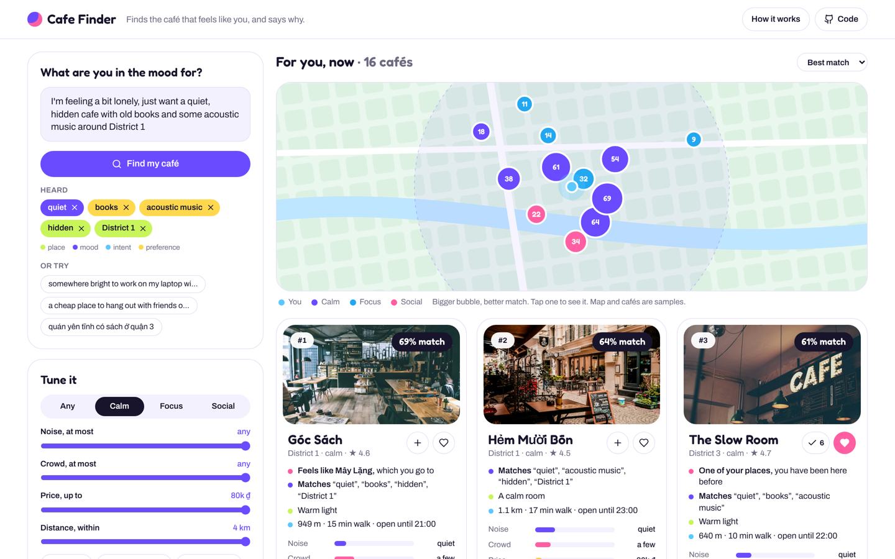

# Cafe Finder

Describe the café you want the way you would tell a friend. Cafe Finder picks out the keywords, learns your taste from the places you go, and ranks cafés with a reason on every card.

**Try it:** https://donganh1409.github.io/perfect-cafe-finder/



## What you can do in the demo

- **Ask in your own words**, in English or Vietnamese. The keywords it heard appear as chips (place, mood, intent, preference), and you can remove any of them.
- **Tune it** with a vibe (calm, focus, social) and hard limits: noise, crowd, price, distance, open now, Wi-Fi and outlets, pets, outdoor seats.
- **Teach it your taste.** Tap **+** on cafés you go to and ♥ the ones you love. *Your café DNA* shows what your places have in common, and the ranking changes as you add visits.
- **See why.** Each card names a café you know that it feels like, the words it matches, a trait you share, and the walk. *Why this score* opens the parts of the score.

The cafés, places and numbers are invented sample data, and the photos come from Unsplash. Your visits are kept only in your browser (`localStorage`).

## How the ranking works

```
score = 0.50 · words  +  0.35 · taste · words  +  0.15 · nearness
```

| Part | What it measures |
|---|---|
| words | The share of your keywords a café satisfies. A keyword can be partly met, for example a café a little louder than "quiet". |
| taste | Cosine similarity between the café and your visits. A loved café counts double. Both sides are measured in standard deviations from the average café, so taste rewards what makes your places *different*, and a 0–1 trait such as quiet weighs as much as a yes/no tag. |
| × words | Taste is multiplied by the word match. What you ask for today beats habit: taste breaks ties among the cafés that fit your words. With no words, taste counts in full. |
| nearness | exp(−distance / 2 km) |

Filters are hard limits, applied before scoring. When you have not given a part yet (no words, no visits), it drops out and the others share its weight.

The engine is in [`src/engine`](src/engine):

- [`keywords.ts`](src/engine/keywords.ts) finds keywords with a small bilingual lexicon, so the demo runs without an API key.
- [`rank.ts`](src/engine/rank.ts) holds the features, the taste vector, the café DNA, the score and the reasons.
- [`__tests__`](src/engine/__tests__/engine.test.ts) has tests for every rule above.

The Python engine in [AI-Engine-Prototype](https://github.com/SEATSCOUT-SOCIAL-APP-TEAM/AI-Engine-Prototype) does the keyword step with an LLM and asks for the same four kinds of keyword.

## Run it yourself

```bash
git clone https://github.com/donganh1409/perfect-cafe-finder.git
cd perfect-cafe-finder
npm ci
npm run dev      # http://localhost:8080/perfect-cafe-finder/
npm test         # engine tests (vitest)
npm run build    # static site in docs/; a workflow copies it to gh-pages
```

Stack: Vite, React 18, TypeScript, Tailwind CSS. There is no backend.

## Who did what

Dong Anh Nguyen designed the personalisation and built this demo: the taste model, the café DNA, the scoring and the explanations. The keyword step and the engine architecture belong to the SeatScout social app team's [AI-Engine-Prototype](https://github.com/SEATSCOUT-SOCIAL-APP-TEAM/AI-Engine-Prototype).

## Limits

- The sample has 16 cafés on a stylised map. Real use needs real venues, opening hours and distances.
- The lexicon only understands the words it lists. The LLM step in the Python engine is the general version.
- Taste starts cold: with no visits, results ignore taste until you tap **+** or ♥.
