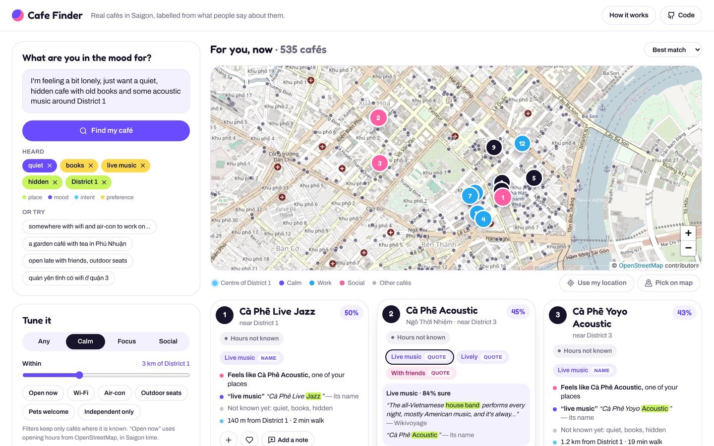

# Cafe Finder

Describe the café you want the way you would tell a friend. Cafe Finder searches **1,441 real cafés in Ho Chi Minh City** on an OpenStreetMap map, labels each one from what people say about it, learns your taste from the places you go, and explains every pick.

**Try it:** https://donganh1409.github.io/perfect-cafe-finder/



## What you can do

- **Ask in your own words**, in English or Vietnamese. The keywords it heard appear as chips (place, mood, intent, preference).
- **See it on a real map.** Every café is a dot. Your best matches are numbered. You can use your location or pick a spot on the map.
- **Open any label to see its evidence**: the OpenStreetMap tag, the opening hours, or the sentence someone wrote, with the words that made the label highlighted.
- **Add a note** to any café in your own words. As you type, it shows the labels it hears. Save the note and the ranking updates.
- **Teach it your taste.** Tap **+** on cafés you go to and ♥ the ones you love. *Your café DNA* shows what your places have in common.
- **Filter on what is known**: open now (Saigon time), Wi-Fi, air-con, outdoor seats, pets, independent only.

## From what people say to a ranked list

```
1 Collect   OpenStreetMap cafés in Ho Chi Minh City, with their tags and opening hours
2 Read      what people say: OSM and Wikivoyage descriptions, notes written after reading reviews, your notes
3 Label     a bilingual reader turns each sentence into labels, hears negation, keeps the sentence as evidence
4 Rank      0.50 · words + 0.35 · taste · words + 0.15 · nearness
5 Explain   every label opens to its evidence; every card says what is still unknown
```

**Labelling.** Each label has a confidence that depends on where it came from:

| Source | Example | Confidence |
|---|---|---|
| Opening hours | closes after 22:30 → *open late* | 0.95 |
| OpenStreetMap tag | `internet_access=wlan` → *Wi-Fi* | 0.90 |
| Your note | "Quiet upstairs, lots of old books" → *quiet*, *books* | 0.85 |
| Dong Anh's notes | written after reading the café's reviews | 0.80 |
| A description | Wikivoyage: "the house band performs every night" → *live music* | 0.70 |
| About the chain | "a Vietnamese chain … reasonably priced" | 0.50 |
| Its name | "Cà Phê Sân Vườn Phố Nhỏ" → *garden* | 0.45 |
| Implied | Wi-Fi and air-con → *good for work* | 0.35 |

The reader works sentence by sentence in English and Vietnamese and handles negation: "not too loud" and "không ồn" count against *lively*. When several sources agree, the label gets stronger (1 − Π(1 − confidence)); when they disagree, they cancel out.

**Ranking.** Each keyword counts by how sure we are that the café has it. A label with evidence counts 0.55 + 0.45 × confidence, evidence against it counts 0, and **nothing known counts 0.25, because unknown is not the same as no**. Naming a place ("around District 1") measures distance from that area's centre. Taste is the cosine similarity between a café's labels and the labels of the cafés you visit (a loved café counts double), with both measured against the average café. Taste is then multiplied by the word match, so what you ask for today beats habit.

The code:
- [`src/engine/labels.ts`](src/engine/labels.ts): the lexicon, the sentence reader, tags, hours, and how evidence combines.
- [`src/engine/rank.ts`](src/engine/rank.ts): the score, taste, *Your café DNA*, and the reasons.
- [`src/engine/hours.ts`](src/engine/hours.ts): OpenStreetMap `opening_hours`, in Saigon time.
- [`src/engine/__tests__`](src/engine/__tests__/engine.test.ts): 20 tests.

## Why not Google reviews?

Google's Places API policies do not allow storing review content, or showing Places data on a map that is not a Google Map. So the app links each café to its reviews on Google Maps (**Reviews ↗**) and never copies them. Labels that come from reading reviews are written as notes, in the reader's own words.

## Data

- **Cafés:** © [OpenStreetMap contributors](https://www.openstreetmap.org/copyright), ODbL. Source: the [BBBike extract for Saigon](https://download.bbbike.org/osm/bbbike/Saigon/), snapshot of 31 October 2026. `src/data/cafes.json` is a derived database under the same licence.
- **Descriptions:** [Wikivoyage, Ho Chi Minh City](https://en.wikivoyage.org/wiki/Ho_Chi_Minh_City), CC BY-SA 4.0. The app quotes them with attribution.
- **Map tiles:** © OpenStreetMap contributors, under the [OSM tile usage policy](https://operations.osmfoundation.org/policies/tiles/).
- **Areas** use the old district names people still use, measured from approximate centres. They are not administrative boundaries.

To rebuild the data:

```bash
pip install osmium
curl -O https://download.bbbike.org/osm/bbbike/Saigon/Saigon.osm.pbf
curl -o wikivoyage.txt "https://en.wikivoyage.org/w/index.php?title=Ho_Chi_Minh_City&action=raw"
python scripts/build_data.py Saigon.osm.pbf wikivoyage.txt src/data/cafes.json 2026-10-31
```

**Adding notes to the app for everyone.**
1. In the app, add notes to cafés.
2. Press **Download my notes** in *The data*.
3. Merge the file into [`src/data/notes.json`](src/data/notes.json), which is keyed by OpenStreetMap id.

Notes there show for every visitor as *Dong Anh's notes*.

## Run it yourself

```bash
git clone https://github.com/donganh1409/perfect-cafe-finder.git
cd perfect-cafe-finder
npm ci
npm run dev      # http://localhost:8080/perfect-cafe-finder/
npm test         # engine tests (vitest)
npm run build    # static site in docs/; a workflow copies it to gh-pages
```

Stack: Vite, React 18, TypeScript, Tailwind CSS, Leaflet. There is no backend. Visits, notes and your chosen location stay in your browser.

## Who did what

Dong Anh Nguyen designed the personalisation and the labelling from what people say, and built this app. The keyword step and the engine architecture come from the SeatScout social app team's [AI-Engine-Prototype](https://github.com/SEATSCOUT-SOCIAL-APP-TEAM/AI-Engine-Prototype).

## Limits

- Most cafés have only what mappers recorded. Feelings like *quiet* need someone to say them, which is why the app shows *Not known yet* and asks for notes.
- The lexicon only knows the words it lists. The engine's LLM step is the general version.
- Opening hours that use holidays, months or sunrise are treated as unknown rather than guessed.
